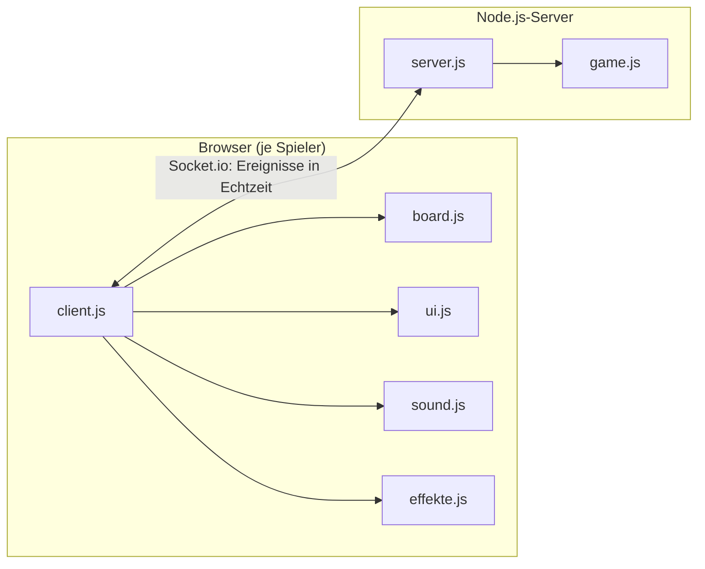
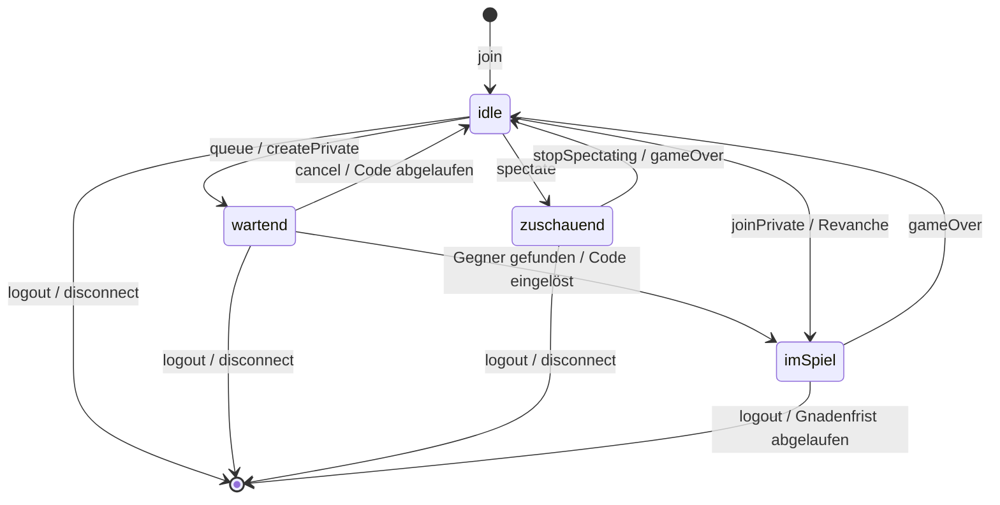

# Hex

Verteiltes Zwei-Personen-Spiel **Hex** im Browser – Portfolioaufgabe im Modul Web-Entwicklung (DHBW Mannheim, W3WI_110.2).

Zwei Personen spielen an verschiedenen Rechnern gegeneinander: Rot verbindet die obere mit der unteren Seite,
Blau die linke mit der rechten. Wer zuerst eine lückenlose Kette eigener Steine zwischen seinen beiden Seiten
baut, gewinnt. Ein Unentschieden ist unmöglich.

- **Frontend:** HTML, CSS und Vanilla JavaScript (ES-Module, kein Framework, kein Build-Tool)
- **Server:** Node.js mit Express und Socket.io – der Server ist die einzige „Wahrheit“ und prüft jeden Zug

---

## Inhalt

1. [Features](#features)
2. [Installation und Start](#installation-und-start)
3. [Spielen im Netzwerk](#spielen-im-netzwerk)
4. [Tests](#tests)
5. [Architektur](#architektur)
6. [Event-Protokoll](#event-protokoll)

---

## Features

### Kern (nach der Spielidee)

- **Anmelden** mit Anzeigename (1–20 Zeichen, geprüft im Browser **und** auf dem Server)
- **Warteschlange** (FIFO) mit animiertem Wartebildschirm, Abbrechen jederzeit möglich
- **Matching:** zwei Wartende bilden ein Spiel, Farben zufällig, Rot beginnt; jedes Spiel in eigenem Socket.io-Raum
- **Spielbrett** 11 × 11 als SVG (121 Sechsecke, Rautenform, farbige Zickzack-Ränder)
- **Zugprüfung auf dem Server:** Spiel aktiv? Spieler gehört dazu? am Zug? Feld gültig und frei?
  Der Browser setzt nie selbst einen Stein – er zeigt nur an, was der Server bestätigt.
- **Sieg-Erkennung per Breitensuche (BFS)** über die 6 Nachbarn, inklusive Gewinnpfad
- **Spielende** für beide Spieler mit Grund (Verbindung, Aufgabe, Zeitablauf, Verlassen), Gewinnpfad leuchtet, Brett gesperrt
- **Aufgeben** (mit Sicherheitsabfrage) und sauberes Aufräumen bei Verbindungsabbruch

### Extras

| | Extra | Kurz erklärt |
|---|---|---|
| B1 | Lobby | Schnelles Spiel, privates Spiel erstellen/beitreten, live „X Spieler online · Y laufende Spiele“ |
| B2 | Private Räume | 4-stelliger Code ohne 0/O/1/I, Kopieren-Knopf, ungültige/abgelaufene Codes werden gemeldet |
| B3 | Schachuhr | 3 Minuten pro Spieler, Server-Timer ist maßgeblich, unter 20 s rot und pulsierend |
| B4 | Swap-Regel | Blau darf den ersten roten Stein übernehmen (gespiegelt an der langen Diagonale) |
| B5 | Spielerlebnis | Koordinaten A–K/1–11, letzter Zug markiert, Fall-Animation, Hover-Vorschau, Zugverlauf, animierter Gewinnpfad, Konfetti, Web-Audio-Töne mit Stummschalter, Tab-Titel „● Du bist am Zug“ |
| B6 | Revanche | gleicher Gegner, Farben getauscht – startet erst, wenn beide zustimmen |
| B7 | Chat & Reaktionen | max. 200 Zeichen, 1 Nachricht/s, Reaktionen 👍 😮 😅 🔥 👏 🤝 steigen über dem Brett auf |
| B8 | Zuschauen | laufende öffentliche Spiele in der Lobby, Live-Ansicht, Zuschauerzahl, private Spiele gesperrt |
| B9 | Rangliste | Siege/Niederlagen pro Name seit Serverstart, Top 10 live in der Lobby |
| B10 | Wiederverbinden | Sitzungs-Token in `sessionStorage`; nach WLAN-Wackler oder F5 zurück ins laufende Spiel (30 s Gnadenfrist) |

### Barrierefreiheit und Design

- Dunkles Theme nach den Mockups, alle Farben zentral als CSS-Variablen in `:root`
- **Kontrast nach WCAG AA** für alle Texte (≥ 4,5 : 1) und Grafiken (≥ 3 : 1) – automatisch geprüft mit `npm run contrast`
- Rot und Blau nie nur über die Farbe: Steine tragen einen Richtungsstrich (Rot senkrecht, Blau waagerecht; in der Legende Rot ↕, Blau ↔), Texte nennen die Farbe
- Komplett per **Tastatur** bedienbar – auch das Brett (Pfeiltasten + Enter, Ansage für Screenreader)
- Sichtbare Fokus-Rahmen, `prefers-reduced-motion` schaltet Animationen ab
- Responsive: ab 1024 × 768 optimal, auf Tablet/Handy ab 375 px spielbar (Panel unter dem Brett, Touch ohne Hover)

### Robustheit

- Jeder Spieler hat genau einen Zustand (`idle`, `wartend`, `imSpiel`, `zuschauend`); Ereignisse im falschen Zustand werden ignoriert
- Alle eingehenden Daten werden geprüft (Typen, Längen, Wertebereiche), Nachrichten max. 16 KB
- Rate-Limit: 20 Ereignisse pro Sekunde und Socket, Chat 1 Nachricht pro Sekunde
- Jeder Handler und jeder Timer ist gegen Fehler abgesichert – kaputte Daten bringen den Server nicht zum Absturz
- Aufräumen bei jedem Verbindungsabbruch (Warteschlange, Spiele, Räume, Timer, Zuschauer)
- Benutzertexte (Namen, Chat) werden im Browser nur per `textContent` eingefügt, nie per `innerHTML`

---

## Installation und Start

Voraussetzung: [Node.js](https://nodejs.org/) ab Version 20 (getestet mit Node 24).
Das Spiel selbst (`npm start`) läuft auch mit Node 18; die Testwerkzeuge Jest und Playwright brauchen Node 20.

```bash
npm install
npm start
```

Danach im Browser öffnen: <http://localhost:3000>

Der Server gibt beim Start auch die Adressen im lokalen Netz aus:

```text
Hex-Server läuft auf http://localhost:3000
Mitspieler öffnen: http://192.168.0.148:3000
```

### Einstellungen über Umgebungsvariablen

| Variable | Standard | Bedeutung |
|---|---|---|
| `PORT` | `3000` | Port des Servers |
| `HEX_HOST` | alle Adressen (IPv4 + IPv6) | Adresse, an die der Server sich bindet |
| `HEX_SSL_CERT` / `HEX_SSL_KEY` | – | Pfade zu Zertifikat und Schlüssel (PEM). Nur wenn beide gesetzt sind, läuft der Server über HTTPS |
| `HEX_ZEIT_MS` | `180000` | Bedenkzeit pro Spieler in Millisekunden (3 Minuten) |
| `HEX_RECONNECT_MS` | `30000` | Gnadenfrist zum Wiederverbinden in Millisekunden |
| `HEX_PRIVAT_MS` | `600000` | Gültigkeit eines privaten Codes in Millisekunden (10 Minuten) |

Beispiel (Linux/macOS): `PORT=8080 HEX_ZEIT_MS=60000 npm start`

---

## Spielen im Netzwerk

1. Auf einem Rechner `npm start` ausführen.
2. Die ausgegebene Adresse `http://<IP-Adresse>:3000` an die Mitspieler weitergeben
   (mit anderem `PORT` entsprechend dessen Nummer statt 3000).
   Alle Geräte müssen im selben Netz sein (z. B. gleiches WLAN).
3. Jede Person öffnet die Adresse im eigenen Browser, gibt einen Namen ein und wählt in der Lobby
   **Schnelles Spiel** – oder erstellt ein **privates Spiel** und gibt den 4-stelligen Code weiter.

Falls die Verbindung nicht klappt, blockiert meist die Firewall den Port:

- **Ubuntu:** `sudo ufw allow 3000/tcp` (bzw. den eingestellten `PORT`)
- **Windows:** beim ersten Start „Zugriff zulassen“ für Node.js bestätigen (privates Netzwerk)

Zum Ausprobieren auf einem einzigen Rechner reichen zwei Browserfenster (z. B. ein normales und ein privates Fenster).

---

## Tests

| Befehl | Was wird geprüft? |
|---|---|
| `npm test` | **Jest**, 94 Tests: Spiellogik (`game.js`: Sieg Rot/Blau, Lücken, Ränder, Zickzack, Gewinnpfad, volles Brett, ungültige Züge, Swap-Regel, Zeitkonto) und Server über echte Socket.io-Verbindungen (Matching, private Räume, Zugprüfung, Aufgabe, Timeout, Revanche, Chat, Zuschauer, Rangliste, Disconnect, Reconnect, kaputte Daten, Rate-Limit) |
| `npm run loadtest` | **Lasttest** mit 40 Bots gleichzeitig: Schnellspiele und private Räume, zufällige gültige Züge bis zum Sieg, Aufgeben, Trennen mitten im Spiel, Wiederverbinden, Zuschauen, Chat-Spam, kaputte Daten, Rate-Limit-Flut. Danach: alle Spiele korrekt beendet, alle Gewinnpfade gültig, Rangliste stimmig, keine Server-Fehler, alle Maps/Timer/Räume leer, Server nimmt weiter Spieler an |
| `npm run contrast` | **Kontrastprüfung** aller Farbpaare aus den CSS-Variablen nach WCAG AA, außerdem: keine festen Farben außerhalb von `:root` |
| `npm run uitest` | **UI-Test mit Playwright** (nur Testwerkzeug): zwei bzw. drei Browser spielen komplette Partien auf 1280 × 800, 1024 × 768 und 375 × 812, inklusive privatem Spiel, Swap, Chat, Zuschauen, Revanche, F5 und Tastaturbedienung. Screenshots landen in `screenshots/`, jede Fehlermeldung in der Browser-Konsole lässt den Test scheitern |

Der UI-Test braucht einmalig den Browser von Playwright: `npx playwright install chromium`.
Lasttest und UI-Test verkürzen die Zeiten (Bedenkzeit, Gnadenfrist) automatisch.

---

## Architektur

```text
hex/
├── server.js            Express + Socket.io: Lobby, Warteschlange, Spiele, Chat, Zuschauen, Wiederverbinden
├── game.js              Reine Spiellogik ohne Netzwerk: Brett, Zugprüfung, BFS-Sieg, Swap-Regel, Schachuhr
├── public/
│   ├── index.html       Single Page mit allen Ansichten (Login, Lobby, Warten, Spiel, Spielende)
│   ├── style.css        Dunkles Theme, alle Farben als CSS-Variablen
│   ├── client.js        Ablauf im Browser: Socket-Ereignisse, Ansichten, Status, Chat, Uhren
│   ├── board.js         Spielbrett als SVG: Felder, Ränder, Koordinaten, Steine, Animationen, Tastatur
│   ├── ui.js            Kleine Helfer: Ansicht wechseln, Meldungen, Namensprüfung
│   ├── sound.js         Töne mit der Web Audio API (live erzeugt, keine Dateien)
│   └── effekte.js       Konfetti auf einem Canvas
├── tests/               Jest-Tests für game.js und den Server
└── scripts/             Lasttest, Kontrastprüfung, UI-Test (Playwright)
```

### Wer macht was?



- **`game.js`** kennt nur das Spiel: Ein `HexSpiel` hat Brett, Zugliste, Spieler am Zug, Ergebnis und Uhren.
  Alle Zeitfunktionen bekommen den Zeitpunkt übergeben (`jetzt`), dadurch ist die Uhr exakt testbar.
- **`server.js`** verwaltet alles Weitere im Speicher (Maps): Spieler, Sitzungen, Warteschlange, Partien,
  private Räume, Rangliste. Er prüft jede Anfrage und schickt den neuen Zustand an alle im Spielraum.
- **Der Browser** schickt nur Wünsche (`move`, `swap`, …) und zeigt an, was zurückkommt.

### Zustände eines Spielers (Server)



`logout` ist in jedem Zustand möglich. Bricht die Verbindung **im Spiel** ab, bleibt der Spieler 30 Sekunden
im Zustand `imSpiel` (Gnadenfrist). In allen anderen Zuständen wird er sofort entfernt. Ein `logout` im Spiel
beendet die Partie sofort ohne Gnadenfrist – der Gegner gewinnt (`reason: 'disconnect'`).

### Wichtige Abläufe

**Ein Zug:** `move { row, col }` → Server prüft (Zustand, am Zug, Zeit, ganze Zahlen 0–10, Feld frei) →
Stein setzen und gleich danach Sieg per BFS prüfen → `state` an alle im Raum → gegebenenfalls
`gameOver { winner, path, reason }`. Bei Fehler geht `invalid { reason }` nur an den Absender.
Sonderfall: War die Zeit des Ziehenden schon abgelaufen, bekommt er `invalid`, und der ganze Raum
bekommt zusätzlich `state` und `gameOver { reason: 'timeout' }`.

**Sieg-Erkennung (BFS):** Alle eigenen Steine am Startrand (Rot: oberste Zeile, Blau: linke Spalte) kommen
in eine Warteschlange. Von dort wird Feld für Feld über die 6 Nachbarn weitergesucht und jeder Vorgänger gemerkt.
Erreicht die Suche den Zielrand, ergibt der Rückweg über die Vorgänger den (kürzesten) Gewinnpfad.

**Nachbarn im Rautenbrett:** Jede Zeile ist um eine halbe Feldbreite nach rechts versetzt. Darum sind die Nachbarn
von (r, c): links/rechts (r, c±1), oben (r−1, c) und (r−1, c+1), unten (r+1, c−1) und (r+1, c).
Ein Jest-Test prüft das gegen die echten Mittelpunkte der gezeichneten Sechsecke.

**Schachuhr:** Jeder Spieler hat ein Zeitkonto. Bei jedem Zug wird die verbrauchte Zeit abgebucht. Ein Server-Timer
feuert genau dann, wenn die Restzeit des Spielers am Zug abläuft. Der Browser zählt nur dazwischen flüssig herunter.

**Swap-Regel:** Nach Rots erstem Zug darf Blau tauschen: Der rote Stein auf (r, c) wird zum blauen Stein auf (c, r)
(Spiegelung an der langen Diagonale), danach ist Rot wieder am Zug.

**Wiederverbinden:** Beim Anmelden bekommt der Browser ein zufälliges Sitzungs-Token (`sessionStorage`). Socket.io
schickt es bei jedem Verbindungsaufbau im Handshake mit. Findet der Server die Sitzung, hängt er den neuen Socket an
den alten Spieler und schickt Spielstand, Uhren und Chat. Nach Ablauf der Gnadenfrist gilt das Spiel als verlassen.

---

## Event-Protokoll

Alle Ereignisse laufen über Socket.io. Daten sind JSON-Objekte; Felder in `[]` sind optional.

### Browser → Server

| Ereignis | Daten | Erlaubt, wenn … | Wirkung / Antwort |
|---|---|---|---|
| *(Handshake)* | `auth: { session }` | beim (Neu-)Verbinden | bekannte Sitzung → `resumed` (+ aktueller Stand), sonst `sessionInvalid` |
| `join` | `{ name }` | noch nicht angemeldet | `joined` oder `joinError`; doppeltes `join` wird ignoriert |
| `queue` | – | `idle` | Warteschlange → `waiting { mode: 'queue' }`, bei zwei Wartenden `gameStart` |
| `cancel` | – | `wartend` | Warteschlange bzw. privaten Raum verlassen → `cancelled` |
| `createPrivate` | – | `idle` | privaten Raum öffnen → `waiting { mode: 'private', code }` |
| `joinPrivate` | `{ code }` | `idle` | mit Code beitreten → `gameStart` für beide oder `privateError` |
| `move` | `{ row, col }` | `imSpiel` | gültig → `state` an den Raum (bei Sieg danach `gameOver`); sonst `invalid` an den Absender – bei abgelaufener Zeit zusätzlich `state` + `gameOver { reason: 'timeout' }` an den Raum |
| `swap` | – | `imSpiel` (Blau, direkt nach Rots 1. Zug) | Swap-Regel → `state` oder `invalid` |
| `resign` | – | `imSpiel` | aufgeben → `gameOver { reason: 'resign' }` |
| `chat` | `{ text }` | `imSpiel` oder nach Spielende | → `chat` an Raum bzw. beide Gegner; zu lang/leer oder zu schnell → `chatError`; in anderen Zuständen ignoriert |
| `reaction` | `{ emoji }` | `imSpiel` oder nach Spielende | nur 👍 😮 😅 🔥 👏 🤝 → `reaction` |
| `rematch` | – | `idle` nach Spielende | Revanche wünschen → `rematchWaiting` / `rematchOffered` / `gameStart` / `rematchCancelled` |
| `leaveGame` | – | `idle` nach Spielende | Spielende-Bildschirm verlassen → Gegner bekommt `rematchCancelled` |
| `spectate` | `{ gameId }` | `idle` | zuschauen → `spectateStart` + `state` oder `spectateError` |
| `stopSpectating` | – | `zuschauend` | Zuschauen beenden → `spectateStopped` |
| `logout` | – | angemeldet | abmelden, Sitzung löschen → `loggedOut` |

### Server → Browser

| Ereignis | Daten | Bedeutung |
|---|---|---|
| `joined` | `{ name, session }` | angemeldet; `session` ist das geheime Token zum Wiederverbinden |
| `joinError` | `{ reason }` | Name ungültig |
| `lobby` | `{ online, games, list: [{ id, red, blue, moves, spectators }], leaderboard: [{ name, wins, losses }] }` | Live-Daten der Lobby; sofort an den eigenen Socket nach `join` und beim Wiederverbinden, sonst an alle gebündelt (Update nach 100 ms, nach Zügen nach 1 s) |
| `waiting` | `{ mode: 'queue' }` oder `{ mode: 'private', code, expiresInMs }` | wartet auf einen Gegner |
| `cancelled` | – | Warten abgebrochen |
| `privateError` | `{ reason }` | Code ungültig, abgelaufen oder schon benutzt |
| `privateExpired` | – | eigener privater Code ist abgelaufen |
| `gameStart` | `{ gameId, color, you, opponent, players: { red, blue }, private, timeMs, [resumed], [chat] }` | Spiel beginnt – oder (mit `resumed`) geht nach einem Abbruch weiter |
| `state` | `{ board, turn, moves: [{ color, row, col, swap }], clock: { red, blue }, swapAvailable }` | aktueller Spielstand (`board[r][c]` = `null` / `'red'` / `'blue'`; `turn` ist `null`, sobald das Spiel beendet ist) |
| `invalid` | `{ reason }` | Zug oder Tausch abgelehnt – Anzeige bleibt unverändert |
| `gameOver` | `{ winner, reason, path, moveCount, players, clock }` | Spielende; `reason`: `connect`, `resign`, `timeout` oder `disconnect`; `path` nur bei `connect` |
| `chat` | `{ from, color, text, time }` | Chat-Nachricht (Text wird im Browser nur als Text angezeigt) |
| `chatError` | `{ reason }` | Nachricht zu lang/leer oder zu schnell |
| `reaction` | `{ from, color, emoji }` | Schnell-Reaktion |
| `rematchWaiting` | `{ opponent }` | eigener Revanche-Wunsch ist beim Gegner |
| `rematchOffered` | `{ from }` | Gegner möchte eine Revanche |
| `rematchCancelled` | `{ reason }` | keine Revanche mehr möglich |
| `spectateStart` | `{ gameId, players, timeMs, chat }` | Zuschauen beginnt (danach `state`) |
| `spectateError` | `{ reason }` | Spiel nicht (mehr) da oder privat |
| `spectateStopped` | – | Zuschauen beendet |
| `spectators` | `{ count }` | Zuschauerzahl im Spiel |
| `opponentDisconnected` | `{ name, color, seconds }` | ein Spieler verbindet gerade neu (Countdown) |
| `opponentReconnected` | `{ name, color }` | der Spieler ist wieder da |
| `resumed` | `{ name, session, state }` | Sitzung erkannt, eigener Stand folgt |
| `sessionInvalid` | – | Sitzung unbekannt (z. B. Gnadenfrist abgelaufen) – neu anmelden |
| `sessionTakenOver` | – | dieselbe Sitzung wurde in einem anderen Tab geöffnet |
| `missedGameOver` | wie `gameOver` | das Spiel endete, während die Verbindung weg war |
| `loggedOut` | – | abgemeldet |

---

## Grundlage

Basis ist die eigene Spielidee (Präsentation „Hex – Ein verteiltes Zwei-Personen-Spiel mit HTML, CSS und JavaScript“)
mit Login, Warten, Spiel, Spielende und dem Protokoll `join` → `gameStart` → `move` → `state`/`invalid` → `gameOver`.
